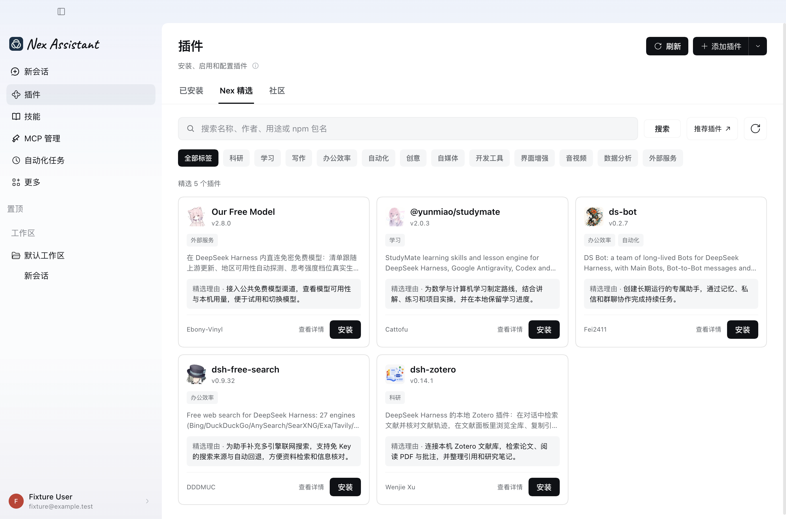
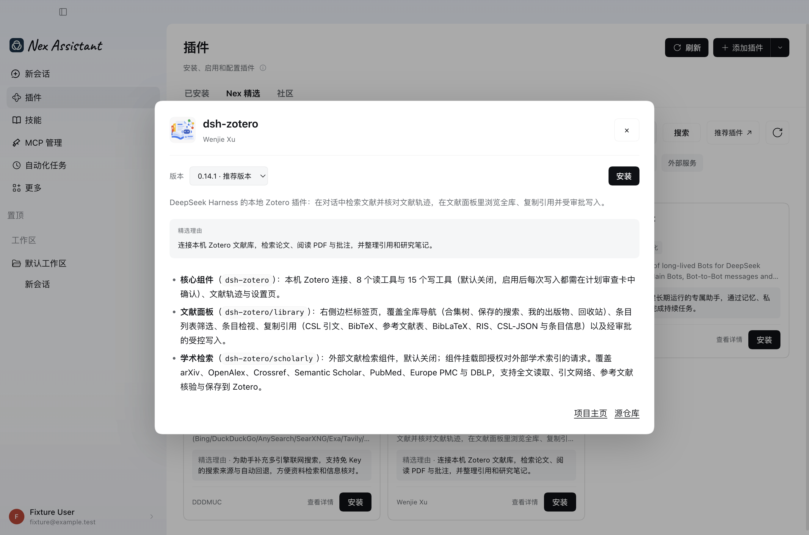

  <strong>为你的创意，添加一份助力</strong> 
  Nex Assistant 官方精选 · 按需安装 · 独立更新

  
  
  
  

  <a href="#开始使用">开始使用</a> ·
  <a href="#精选内容">精选内容</a> ·
  <a href="#客户端预览">客户端预览</a> ·
  <a href="CONTRIBUTING.md">贡献指南</a> ·
  <a href="docs/maintenance.md">维护与接入</a>

Nex 精选收录适合研究、学习、创作与日常工作的插件，由官方维护者挑选并说明推荐理由。社区插件与 Nex 自研插件都可以被收录，插件由原作者在 npm 或 GitHub 维护和发布。

## 开始使用

1. 在 Nex Assistant 侧栏打开 **插件 → Nex 精选**。
2. 搜索名称或用途，也可以点击标签筛选；点击插件名称或 **查看详情** 阅读原作者的使用说明。
3. 点击卡片上的 **安装**，在弹窗中查看安装进度。
4. 安装完成后点击 **启用插件**，按插件说明完成配置；界面提示需要重启时，再重启应用。

安装后的启停、配置和更新入口位于 **已安装**。想发现更多插件，可以切换到旁边的 **社区**。

## 精选内容

| 插件 | 适合用来做什么 | 标签 |
| --- | --- | --- |
| [Zotero](https://github.com/Vncntvx/dsh-zotero) | 检索本机文献库，阅读论文与批注，整理引用和研究笔记 | 科研 |
| [StudyMate](https://github.com/Miaotofu01/Study-Mate) | 规划数学与计算机学习路线，配合讲解、练习与项目实操 | 学习 |
| [DS Bot](https://github.com/Fei2411/DS-Bot) | 创建长期运行的助手，通过记忆、私信和群聊协作完成任务 | 办公效率、自动化 |
| [Free Search](https://github.com/DDDMUC/dsh-free-search) | 为助手补充多引擎联网搜索，检索资料、核对信息 | 办公效率 |
| [Our Free Model](https://github.com/Ebony-Vinyl/dsh-our-free-model) | 接入公共免费模型渠道，查看可用性与本机用量 | 外部服务 |

最新收录见 [插件清单](plugins)。可安装版本与兼容状态以客户端显示为准；具体配置、服务限制和许可证见各插件的原始说明。

## 客户端预览

卡片展示插件简介、用途标签与精选理由，可以直接查看详情或安装。每个插件最多三个标签，点击卡片上的标签也能筛选。

<picture>
  <source media="(prefers-color-scheme: dark)" srcset="docs/images/nex-curated-dark.png">
  <source media="(prefers-color-scheme: light)" srcset="docs/images/nex-curated-light.png">
  
</picture>

查看插件详情示例

以上为 Nex Assistant 客户端实图。[查看深色界面](docs/images/nex-curated-dark.png) · [图片说明](docs/images/README.md)

## 推荐插件与反馈

- **推荐插件**：填写 [推荐插件表单](https://github.com/xhznAI/nex-plugin/issues/new?template=plugin-request.yml)，提供来源、用途和实际使用情况。
- **提交收录 PR**：在 `plugins/` 添加来源清单，按 [贡献指南](CONTRIBUTING.md) 检查后提交。
- **反馈目录问题**：遇到信息错误、失效来源或标签问题，请 [提交 Issue](https://github.com/xhznAI/nex-plugin/issues/new?title=%5B%E5%8F%8D%E9%A6%88%5D%20)。插件自身的功能与配置问题，请前往详情中的源仓库反馈。

官方自研插件和社区插件使用同一套收录流程。精选清单由 Nex 维护者决定，资料和版本从已收录来源自动同步。

维护目录、生成索引或接入客户端与镜像，见 [维护与接入文档](docs/maintenance.md)。

## 致谢

感谢以下项目的维护者与贡献者：

- [DeepSeek Harness](https://github.com/deepseek-ai/deepseek-harness)：提供插件生态、安装能力，以及本仓库使用的索引校验和详情读取库。
- [DSH 社区精选仓库](https://github.com/DshMarketPlace/awesome-dsh-plugin)：为来源收录与资料同步方式提供参考。
- [dshworks 插件目录](https://github.com/dshworks/awesome-dsh-plugins)：为公开插件目录与标准索引生成方式提供参考。
- 各收录插件的原作者与社区贡献者：持续维护插件、完善文档并分享使用经验。

本仓库工具代码采用 [MIT License](LICENSE)。收录插件保留各自的作者归属与许可证。

---

Maintained by [zhoufeiyu · xhznAI](https://github.com/xhznAI) · [贡献指南](CONTRIBUTING.md) · [MIT License](LICENSE)
